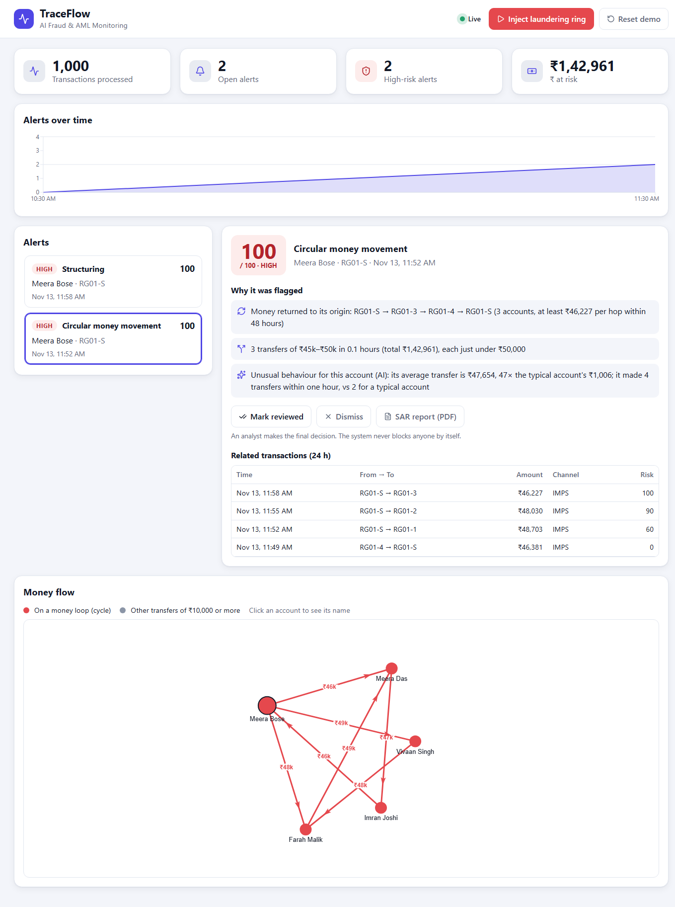
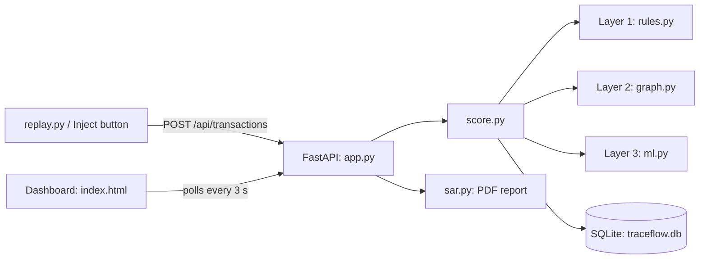

# TraceFlow: AI Fraud Detection & Anti-Money Laundering

A working prototype that scores every transaction for risk, catches money-laundering patterns on a transaction graph, and **explains in plain English why** each alert was raised. Built solo for a hackathon. All data is synthetic, in ₹.

## Problem

Banks must spot fraud and money laundering in a flood of transactions. Models that only output a score are hard to trust and hard to review. Analysts need to know *why* something was flagged, and laundering shows up as **patterns between accounts** (loops, splitting, mule accounts), which a per-transaction classifier cannot see.

## Solution

TraceFlow scores each incoming transaction from 0 to 100 using three layers, creates an alert from 40 upwards, and shows the reasons, the money-flow graph and a one-page Suspicious Activity Report (SAR). The system never blocks anyone: a human analyst decides.



## Architecture



## The three detection layers

1. **Rules** (`rules.py`): structuring (3+ transfers of ₹45k–₹50k in 24 h), velocity (too many transactions in an hour), pass-through (80% of a large inflow sent on within 6 h), amount spike (more than 10× the account's median).
2. **Graph AML** (`graph.py`): money loops through 3–6 accounts within 48 h, fan-in and fan-out (8+ counterparties in 24 h). Only transfers of ₹10,000 or more count.
3. **AI anomaly detection** (`ml.py`): an IsolationForest learns what a normal account looks like (average amount, transfers per hour, counterparties, night-time share, money in vs out). An account that looks very different gets +30 points and a reason such as "its average transfer is ₹47,654, 47× the typical account's ₹1,006".

Points from all layers are added and capped at 100. Low is under 40, medium 40–69, high 70 and above. Every reason contains real numbers. The AI layer adds evidence but cannot raise an alert on its own.

## Live demo

**https://traceflow-hs43.onrender.com**

Open the page, click **Start live feed** (optional: about a minute of calm traffic streamed by the server), then click **Inject laundering ring**. No scripts are needed. On Render's free plan the site sleeps when idle and takes about a minute to wake up, and the data resets whenever it restarts.

Deploy on Render (Python web service, no Docker, no Node, no training): the built dashboard (`frontend/dist`) and the trained model (`backend/models/iforest.joblib`) are committed. Either use **New > Blueprint** with `render.yaml`, or create a Web Service with build command `pip install -r requirements.txt` and start command `uvicorn backend.app:app --host 0.0.0.0 --port $PORT`. `.python-version` pins Python 3.12.

## How to run

Windows PowerShell, from the repo root. Needs Python 3.12. Node.js (LTS) is only needed to change the dashboard.

dist is prebuilt; rebuild with npm run build after UI changes.

```powershell
python -m venv .venv
.\.venv\Scripts\python.exe -m pip install -r requirements.txt

# only after changing the UI: rebuild the React dashboard (output goes to frontend/dist)
cd frontend; npm install; npm run build; cd ..

# start the server (dashboard at http://localhost:8000, API docs at /docs)
.\.venv\Scripts\python.exe -m uvicorn backend.app:app

# in a second terminal: stream normal traffic (add --delay 0 for a fast load)
.\.venv\Scripts\python.exe scripts/replay.py --calm --delay 0.3
```

Open `http://localhost:8000` and click **Inject laundering ring**. Two high alerts appear: a money loop and structuring. Click an alert to see the reasons, the graph with the loop in red, and **Open SAR report (PDF)**. **Reset demo** starts over.

Other commands:

```powershell
.\.venv\Scripts\python.exe -m pytest -q         # 16 tests
.\.venv\Scripts\python.exe scripts/train.py     # retrain the AI layer (a trained model is included)
```

`HOW_IT_WORKS.md` explains each file in one or two lines.

## Results

Measured on our synthetic data (no real or benchmark dataset was used):

- 993 normal transactions replayed: **0 alerts**.
- Injected ring (7 transfers): **2 high alerts** (cycle and structuring, both 100) in under 100 ms.
- The AI layer tags about 9% of the normal transactions as unusual (it is set loose on purpose). That adds 30 points and never produces an alert on its own.
- 16 automated tests pass, covering each rule, cycles of 3 and 5 accounts, chains and oversized loops that must not match, fan-in and fan-out, input validation, the alert API, the SAR PDF, the AI layer and the live feed.

We report no accuracy, precision or recall. Our own generator creates both the normal traffic and the laundering patterns, so those numbers would only show that the detectors find what we planted.

## Limitations

- Synthetic data only. It needs validation on real, labelled data before any real use.
- Thresholds (₹45k–₹50k, 8 counterparties, 48 h window, point weights) are tunable assumptions, not regulatory values.
- A large payroll run (8+ salaries in a day) looks like fan-out and would be a false positive. A production system would whitelist known payers.
- Cycles are found in a time window without checking the order of transfers.
- The IsolationForest is trained on our generator's idea of normal. Real customers behave differently.
- "Real-time" means a replay script plus dashboard polling every 3 seconds. There is no Kafka, no authentication and no multi-user support.
- The SAR is a draft in a simple format, not a regulatory filing.

## Responsible AI

- Humans make the final decision. Alerts are for review, never for automatic blocking.
- Every alert explains itself in plain language with specific numbers.
- No real customer data and no personal information. All names and account IDs are synthetic.
- The ground-truth column `is_synthetic_bad` exists only for evaluation and is never used for scoring.
- The AI layer is deliberately limited to supporting evidence, so a statistical oddity alone cannot trigger an alert.

## Tech stack

Python 3.12, FastAPI, uvicorn, SQLite (built-in `sqlite3`), networkx, scikit-learn (IsolationForest), reportlab, pytest. Frontend: React (Vite, JavaScript) with recharts, react-force-graph-2d and lucide-react, plain CSS with light and dark mode. `npm run build` outputs to `frontend/dist`, which FastAPI serves, so the demo runs with one command.
